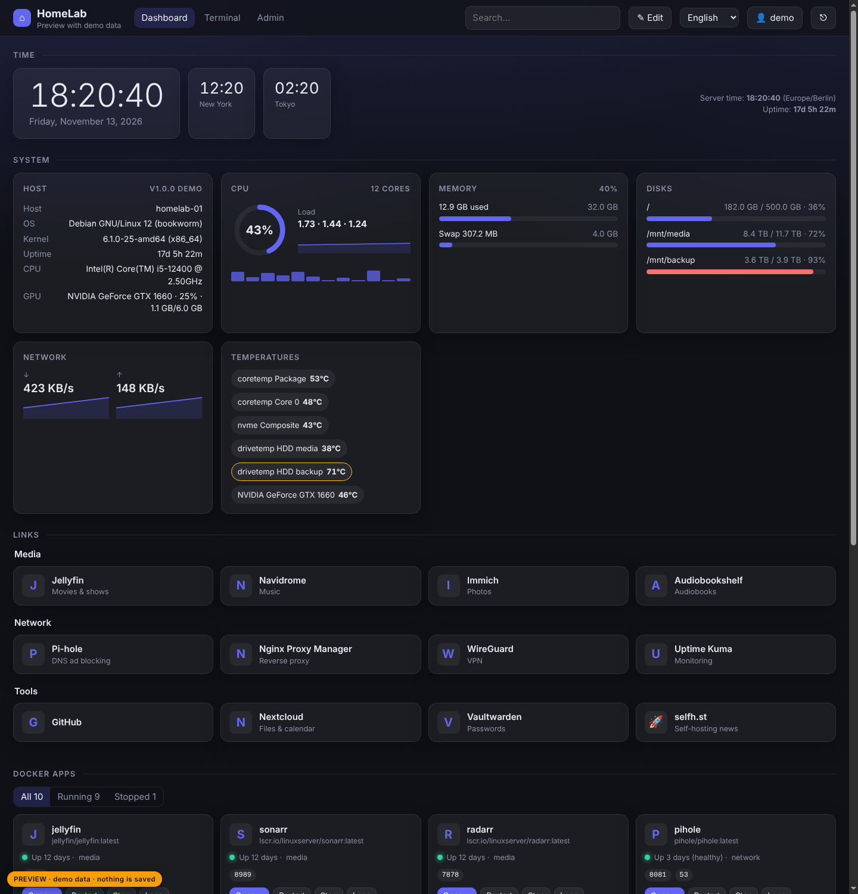
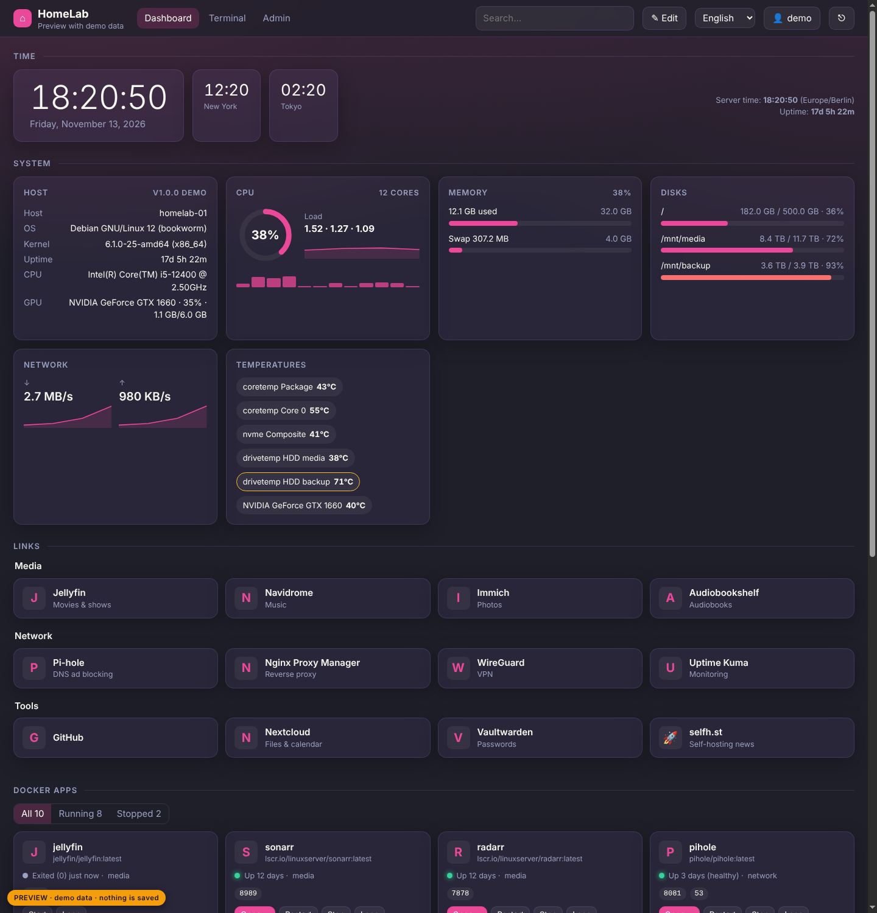
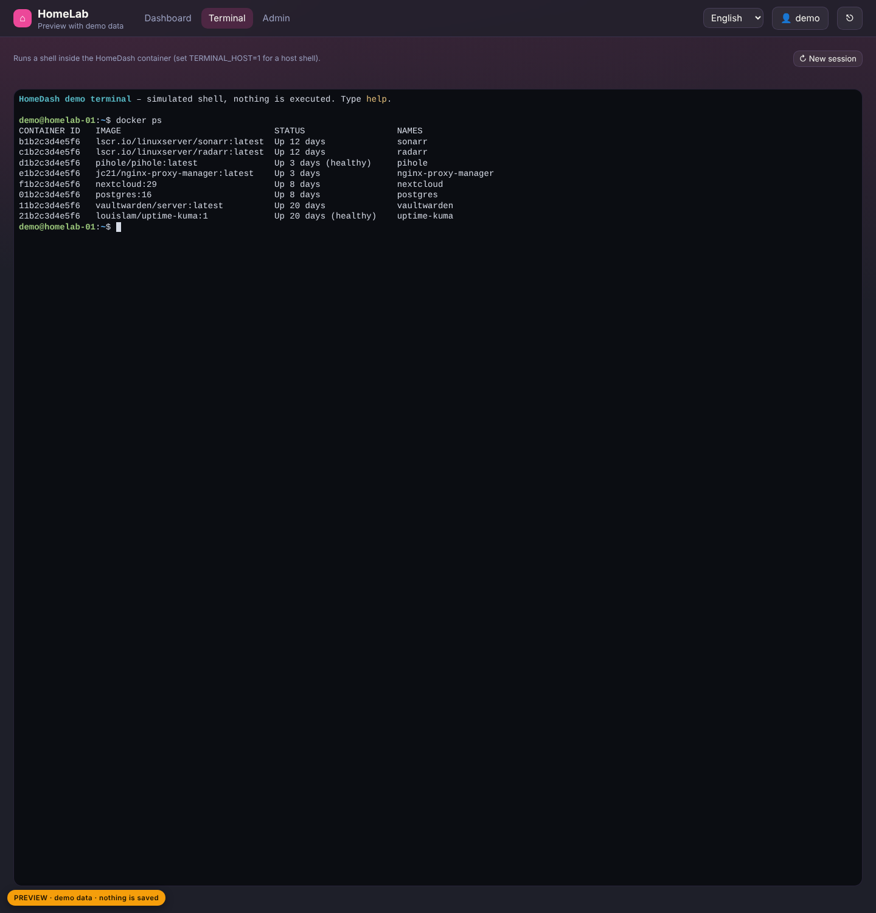

<div align="center">

# ⌂ HomeDash

**The all-in-one dashboard for self-hosters, homelabs, VPS and servers.**

Hardware stats · Docker & Compose · Links with logos · Home Assistant · Web terminal · Users & admin panel




</div>

---

## Why HomeDash?

Most dashboards are just a page of bookmarks. HomeDash is a **live control panel** for the machine it runs on: see what your hardware is doing, manage your containers, jump to your apps, control your smart home, and open a shell – all from one tab, protected by real user accounts.

It is a single small Python process with **no pip or npm dependencies** and a plain JavaScript frontend. No build step, no database, no external services.

## Features

| | |
|---|---|
| 🖥 **Hardware & system** | CPU model, cores, live usage (per core), load, RAM, swap, disks, NVIDIA GPU, network throughput graphs, uptime |
| 🌡 **Temperatures** | All sensors from `hwmon` / thermal zones plus GPU, with warning colors |
| 🕒 **Time** | Local clock, extra clocks for other time zones, server time, 12/24-hour |
| 🐳 **Docker apps** | Every container with status, ports, one-click *Open*, start / stop / restart, logs |
| 🧩 **Docker Compose** | Projects grouped automatically; start, stop, restart, `up -d`, `pull`, `down`, and edit the YAML in the browser |
| 🔗 **Links & logos** | Categories and tiles with automatic favicons, [Dashboard Icons](https://github.com/homarr-labs/dashboard-icons) (`di:jellyfin`), emoji or image URLs; drag & drop; instant search |
| 🏠 **Home Assistant** | Show and toggle lights, switches, scenes, scripts… and feed server metrics *into* Home Assistant with an API token |
| ⌨ **Web terminal** | Real PTY shell in the browser (xterm.js, with a built-in fallback), admins only |
| 👥 **Users & roles** | First-run setup, admin / user roles, per-user language and theme, password change |
| 🛠 **Admin panel** | General settings, appearance, integrations, users, API tokens, backup / restore |
| 🎨 **Customizable** | 7 themes, accent color, corner radius, columns, card style, background image, widget order & visibility, custom CSS |
| 🌍 **Multi-language** | English, Deutsch, Español, Français – easy to add more |

<details>
<summary><b>More screenshots</b></summary>




</details>

> **Try it without installing:** open [`preview.html`](preview.html) in your browser for a fully clickable demo with sample data.

## Quick start

### Option 1 – Docker (recommended)

```bash
git clone https://github.com/YOUR_USER/homedash.git
cd homedash
./install.sh
```

The installer copies HomeDash to `/opt/homedash`, builds the image and starts it on port **8080**. Use `./install.sh --port 9000` for another port.

Prefer to do it by hand?

```bash
docker compose up -d --build
```

### Option 2 – No Docker (only Python 3)

```bash
./install.sh --native     # installs a systemd service
# or simply:
python3 server.py         # data in ./data, listens on :8080
```

### First start

Open `http://<server-ip>:8080`. HomeDash asks you to create the **admin account** – that's it.
(To skip the wizard, set `ADMIN_USER` and `ADMIN_PASSWORD`.)

Uninstall with `./install.sh --uninstall` (your data is kept).

## Docker setup explained

```yaml
services:
  homedash:
    build: .
    container_name: homedash
    restart: unless-stopped
    ports: ["8080:8080"]
    environment:
      - TZ=Europe/Berlin
    volumes:
      - ./data:/data                                  # settings, users, icon cache
      - /var/run/docker.sock:/var/run/docker.sock     # Docker apps + Compose control
      - /etc/os-release:/host/etc/os-release:ro       # host OS name
      - /etc/hostname:/host/etc/hostname:ro           # host name
      - ./stacks:/compose                             # your compose projects (one folder each)
```

Don't want Docker control? Remove the socket line – the rest keeps working.

### Docker labels

Fine-tune how a container appears on the dashboard:

```yaml
labels:
  homedash.name: "Movies"
  homedash.url: "https://jellyfin.example.com"
  homedash.icon: "di:jellyfin"
  homedash.description: "Media server"
  # homedash.hide: "true"
```

## Configuration

| Variable | Default | Description |
|---|---|---|
| `PORT` / `BIND` | `8080` / `0.0.0.0` | Listen port and address |
| `DATA_DIR` | `./data` | Settings, users, tokens, icon cache |
| `DOCKER_SOCKET` | `/var/run/docker.sock` | Docker API socket |
| `COMPOSE_DIR` | `/compose` | Folder with one sub-folder per Compose project |
| `HOST_ROOT` | – | Where host files are mounted (e.g. `/host`) |
| `DISK_PATHS` | auto | Choose disks: `Label:/path,Label2:/path2` |
| `TERMINAL_HOST` | `0` | `1` = shell on the **host** (needs `pid: host` and `privileged: true`) |
| `SECURE_COOKIE` | `0` | Set `1` when served over HTTPS |
| `SESSION_HOURS` | `168` | Login lifetime |
| `ADMIN_USER`, `ADMIN_PASSWORD` | – | Create the first admin from the environment |

## Home Assistant

**Show your smart home on the dashboard**
1. In Home Assistant open your profile → *Security* → create a **long-lived access token**.
2. In HomeDash go to *Admin → Integrations*, enter the URL and token, click *Test connection*, then *Pick entities*.

**Send server stats to Home Assistant**
1. *Admin → API tokens* → create a token.
2. Copy the generated `rest:` block into Home Assistant's `configuration.yaml`. You get CPU, RAM and temperature sensors.

API tokens are read-only: they can read `/api/system`, `/api/docker/containers` and `/api/compose/projects`, nothing else.

## Customizing

Everything visual is a CSS variable. Override it in *Admin → Appearance → Custom CSS*:

```css
:root {
  --accent: #ff6b6b;
  --radius: 20px;
  --bg: #0b1020;
}
```

**Add a language:** copy the `en` block in `static/i18n.js`, translate it, add the code to `LANGS` in `server.py` and to `LANG_NAMES` in `i18n.js`. Missing keys fall back to English.

**Offline terminal:** place `xterm.js`, `xterm.css` and `addon-fit.js` (from `@xterm/xterm` 5.x and `@xterm/addon-fit`) in `static/vendor/`. The Dockerfile and installer do this automatically when the network allows. Without them HomeDash uses a built-in basic terminal.

## Security

HomeDash can control your server, so please read this:

- Mounting the **Docker socket** and enabling the **terminal** give admins root-equivalent control of the host. Only create admin accounts for people you trust.
- Put HomeDash behind **HTTPS** (e.g. Caddy, Traefik or Nginx Proxy Manager) if it is reachable from the internet, and set `SECURE_COOKIE=1`.
- Turn the terminal off in *Admin → Integrations* if you don't need it.
- Passwords are hashed with PBKDF2-SHA256, sessions are signed, `HttpOnly` and `SameSite=Strict`, state-changing requests require a custom header (CSRF protection) and logins are rate limited.
- Users with the *user* role can view the dashboard and use Home Assistant tiles. Docker actions, logs, Compose, the terminal and all admin pages are admin-only.
- Home Assistant tokens are stored in `data/config.json` (file mode `600`) – back it up carefully.

Found a vulnerability? Please open a private security advisory instead of a public issue.

## Project layout

```
homedash/
├── server.py          # backend (Python standard library only)
├── static/
│   ├── index.html
│   ├── app.js         # dashboard, widgets, links
│   ├── admin.js       # admin panel
│   ├── terminal.js    # web terminal
│   ├── i18n.js        # translations
│   └── style.css      # themes & layout
├── Dockerfile
├── docker-compose.yml
├── install.sh
└── preview.html       # clickable demo with sample data
```

## Contributing

Issues and pull requests are welcome. Good first contributions: new translations, new themes, new widgets. Keep it dependency-free.

## License

[MIT](LICENSE)
